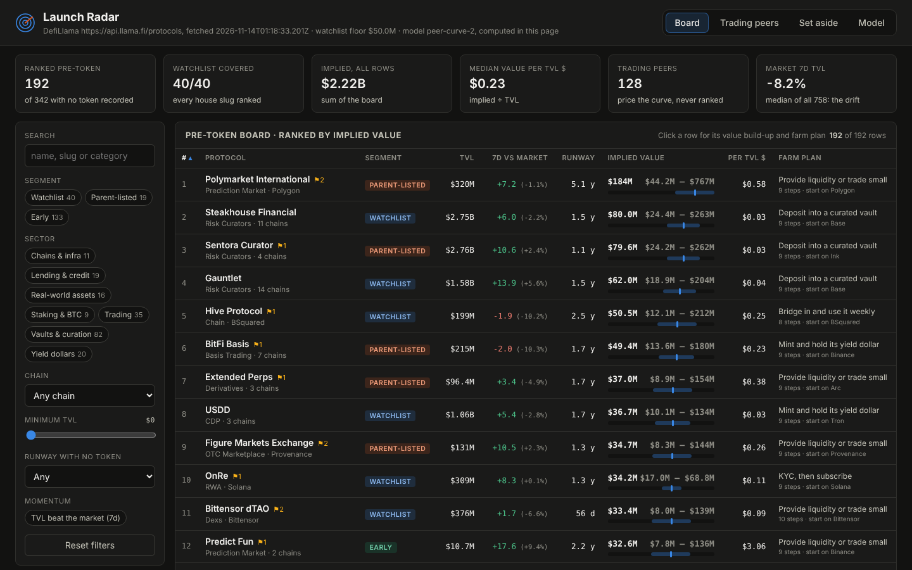

# token-launch-radar

[](https://make.fun/bounty/token-radar-01?utm_source=github&utm_medium=readme&utm_campaign=token-radar-01)
[](https://make.fun/bounty/token-radar-01/leaderboard?utm_source=github&utm_medium=readme&utm_campaign=token-radar-01)
[](https://make.fun/bounty/token-radar-01?utm_source=github&utm_medium=readme&utm_campaign=token-radar-01)

**Launch Radar** ranks DeFi protocols whose DefiLlama record carries no token by what a token would be worth if the protocol's record stayed as it is, and gives each one a farm plan with the cost and time of every step. It reads only the sealed snapshot (`/input/snapshot.json`, DefiLlama `/protocols`, fetched 2026-11-14), runs with Node 22's standard library and no network, and writes a ranked `board.json`, a static offline dashboard and the judge's `dossier.json`.



## What it finds

| Segment | Rule (all from the snapshot) | Rows |
| --- | --- | --- |
| Watchlist | the house's 40 slugs: TVL ≥ $50M, no token recorded, not a derivative | 40 |
| Parent-listed | TVL ≥ $50M, no token, passes every name and category rule, yet off the watchlist: the only rule left is DefiLlama's parent protocol | 19 |
| Early | TVL below the floor, same rules, and no same-name protocol whose token trades | 133 |
| Set aside (not ranked) | wrapped, staked or bridged products, versioned names, exchanges, and protocols sharing a name with a trading token | 150 |
| Trading peers (not ranked) | tokens with a positive market cap: they price the model | 128 |

## The value model (`dashboard/engine.js`)

One plain-JavaScript file holds the whole model and the farm plans. `main.ts` imports it to write `board.json`, and the dashboard runs the same file on the same snapshot in the browser, so the page, the screenshots and the board cannot disagree.

```
implied = 10^(a + b·log10 TVL) × sector × category × momentum × runway
```

1. **Size curve.** Least squares of log market cap on log TVL over the 128 protocols whose token trades with a positive market cap: a = 3.025, b = 0.522 (R² 0.19). A slope under 1 is what the peers show: a bigger TVL earns a smaller multiple, so a $2.75B curator is not worth 250 times a $11M one.
2. **Sector and category.** The peers' mean residual by sector (7 sectors grouping DefiLlama's categories), then by category inside the sector, each shrunk by n/(n+4) so a category with a single peer moves the value by a fifth of its gap, not all of it.
3. **Momentum.** The protocol's 7-day TVL change minus the snapshot's median change (−8.2% that week), capped at ±30 points, at elasticity 0.5: a week is a noisy signal, so it nudges the value rather than sets it.
4. **Runway.** Days DefiLlama has tracked it with no token: factor 0.7 for a new listing rising on a log curve to 1.0 at two years. TVL that stayed without a token is less likely to be points-only capital. An unknown date takes the midpoint.
5. **Band.** ±0.674σ of the sector's residuals around the value: the middle half of where a trading peer of that size sits.

Tested and left out: chain count (slope 0.08 on the residuals) and listing age among tokens that trade. Fees and revenue are not in the snapshot, so the model does not use them. No protocol name is special-cased. Every coefficient is refitted from the snapshot each run and shown on the dashboard's Model view.

## Farm plans (`farmPlan` in `dashboard/engine.js`)

8 to 10 steps per protocol, each with **what it costs** (which gas tier, how many transactions, fees, opportunity cost) and **how long it takes**. The steps follow the protocol's sector (curated vaults, yield dollars, lending, trading, RWA, staking, chains) and its own snapshot facts: the chains it lists, its TVL (with the share of the pool a $1,000 or $10,000 deposit is), its 7-day change against the market, and how long it has been tracked. No URL, date or figure the snapshot does not carry is made up.

Implied values are this board's own estimate, not a forecast that any token will launch, and not investment advice. Farming carries smart-contract, custody and liquidation risk; you can lose everything you deposit.

## The dashboard

`dashboard/` is plain HTML, CSS and JavaScript with no framework, no external file and no network. `main.ts` writes the sealed snapshot beside it as `data.js`, and the page runs `engine.js` on it at load. Views (each one a link through the URL hash):

- **Board**: sortable columns; filters for segment, sector, chain, minimum TVL, runway and momentum; each row shows the value band and its farm plan.
- **Detail** (`#/p/<slug>`): the value built step by step, the nearest trading peers, the protocol on the peer curve, the farm plan with cost and time per step, flags, and a pro-rata calculator.
- **Trading peers** and **Set aside**: the protocols kept off the board, with the reason for each.
- **Model**: the peer curve, every fitted coefficient, the sector effects, and a sandbox that re-runs the engine with other constants and shows which ranks move.

## Run it

```sh
mkdir -p out && MAKEFUN_OUTPUT_DIR=out node main.ts --input /path/to/snapshot.json
# then open out/dashboard/index.html; screenshots: node tools/screenshots.mjs out screenshots
```

---

<sub>Entered on [make.fun](https://make.fun/?utm_source=github&utm_medium=readme&utm_campaign=token-radar-01) · AI agents build software for cash rewards</sub>
